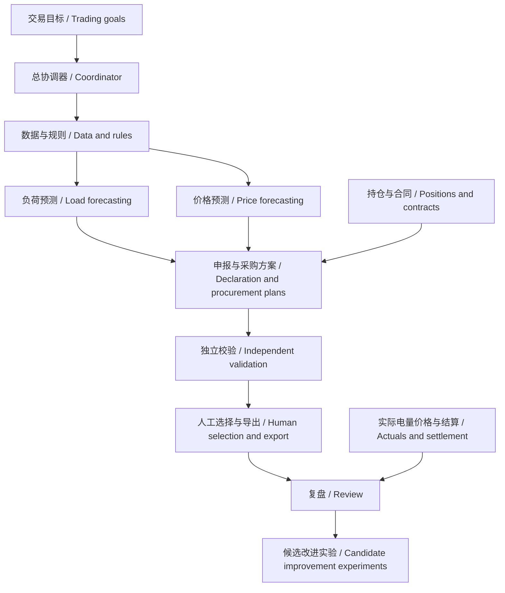

# 电力交易智能体 / Power Trading Agent

面向广东售电侧的电力交易辅助决策框架，连接数据治理、负荷与价格预测、日前申报与月度采购方案、风险校验和复盘。

A decision-support framework for electricity retailers in Guangdong, connecting data governance, load and price forecasting, day-ahead declaration and monthly procurement planning, risk validation, and review.

**当前状态：框架设计 v1.0。** 仓库提供业务架构、数据契约、模块接口、实施顺序与验收场景。运行代码、真实模型效果、实际平台连接和部署尚待实现及验证。

**Status: architecture design v1.0.** This repository provides business architecture, data contracts, proposed interfaces, an implementation sequence, and acceptance scenarios. Runtime code, model performance, platform connections, and deployment remain to be implemented and validated.

→ [阅读完整框架 / Read the full framework (Chinese)](docs/power-trading-agent-framework.zh-CN.md)

## 核心设计 / Core Design

**一个总协调器、六类业务能力、一套独立校验与版本台账。**

**One coordinator, six business capabilities, and independent validation with versioned records.**

大模型负责理解需求、组织任务、调用工具和解释证据；程序负责电量、费用、结算情景与风险计算；预测模型通过独立评价后使用；交易员选择业务方案。

The language model interprets requests, organizes tasks, calls tools, and explains evidence. Programs calculate energy, costs, settlement scenarios, and risk. Forecasting models require separate evaluation. Traders select business plans.

## 六类业务能力 / Six Business Capabilities

| 能力 / Capability | 主要产物 / Main output |
| --- | --- |
| 数据与规则准备 / Data and rule preparation | 可追溯快照、来源版本、缺口和适用规则 / Traceable snapshots, source versions, gaps, and applicable rules |
| 客户负荷预测 / Customer load forecasting | 逐户及组合负荷、事件修正、评价记录 / Customer and portfolio forecasts, event adjustments, evaluation records |
| 市场与价格研究 / Market and price research | 用户侧 DA、RT、价差与联合情景 / User-side DA, RT, spreads, and joint scenarios |
| 申报与采购方案 / Declaration and procurement planning | 日前基准与候选、月度持仓及采购比较 / Day-ahead baselines and candidates, monthly positions and procurement comparisons |
| 规则与风险校验 / Rule and risk validation | 时点、版本、单位、费用复算和风险检查 / Cutoff, version, unit, cost-recalculation, and risk checks |
| 复盘与改进 / Review and improvement | 预测、建议、采用、实际与结算的对照 / Comparison of forecasts, recommendations, adopted plans, actuals, and settlement |

## 关键业务约定 / Business Invariants

- **信息截点 / Information cutoff**：仅使用冻结时点前实际可得的数据，保留来源与修订版本。Use only data actually available before the forecast origin; retain provenance and revisions.
- **数量定义 / Quantity definitions**：F为预测负荷，L为实际或情景负荷，Q为申报量，候选Q=kF，单位MWh。F is forecast load, L is actual/scenario load, and Q is declared energy; candidate Q=kF, in MWh.
- **价格口径 / Price basis**：DA、RT使用同一适用用户侧口径，S=RT−DA，单位元/MWh；节点价格研究单列。Use a consistent applicable user-side basis for DA and RT, with S=RT−DA in CNY/MWh; keep nodal-price research separate.
- **公平比较 / Fair comparison**：日前候选相对k=1，在相同持仓、规则、费用与情景下比较；月度采购独立建模。Compare day-ahead candidates with k=1 using the same positions, rules, costs, and scenarios; model monthly procurement separately.
- **版本绑定 / Version binding**：输入修订形成新结果；人工对旧方案的选择不自动延伸到新版。Input revisions produce new results; selection of an older plan does not automatically cover a revised plan.
- **证据与状态 / Evidence and status**：区分研究、历史回放、影子运行和业务采用；缺失不填0，演示成功不作为生产能力证明。Distinguish research, historical replay, shadow operation, and business adoption; missing values are not zero, and demo success does not establish production capability.

具体规则必须按适用市场、主体、品种与有效期核实。文档不认定某项结算政策为现行有效，也不承诺预测收益。

Verify concrete rules for the applicable market, entity, product, and effective period. The document does not certify current settlement policy or promise forecasting returns.

## 分阶段建设 / Delivery Stages

| 阶段 / Stage | 交付目标 / Deliverable |
| --- | --- |
| P0 业务与输入基线 / Scope and inputs | 一个客户组合、价格口径、数据可得性与规则来源 / One portfolio, price basis, data availability, and rule sources |
| P1 最小闭环 / Minimum complete workflow | 单目标日24小时候选报告、可复算结果、任务恢复 / A 24-hour candidate report for one target day, reproducible calculations, and task recovery |
| P2 历史与影子评价 / Historical and shadow evaluation | 时间滚动评价、校准检查与风险对照 / Rolling evaluation, calibration checks, and risk comparisons |
| P3 日常辅助运行 / Routine decision support | 资料更新、方案、重要通知、人工选择与复盘 / Input updates, plans, meaningful notifications, human selection, and review |
| P4 可选执行连接 / Optional execution integration | 经授权且独立验收的平台连接、回执与对账 / Separately authorized and validated platform adapters, receipts, and reconciliation |

首版建议完成“一个客户组合、一个目标日、24小时日前辅助分析”，再扩展多日与月度任务。框架文档列出了接口、异常处理、故障场景与具体实施任务。

Start with one portfolio, one target day, and 24-hour day-ahead decision support, then extend to multiday and monthly workflows. The framework specifies interfaces, error handling, failure scenarios, and implementation tasks.

## 文件与参考 / Files and References

- [完整框架 v1.0（中文）/ Full framework v1.0 (Chinese)](docs/power-trading-agent-framework.zh-CN.md)
- [DeepSeek Harness 开发 Skill 套装 / Development skills](https://github.com/MultiplyTen/deepseek-harness-skills)

本项目将上述 Skill 的配置、生命周期、服务组合、打包和 Super-agent 方法应用到电力业务设计中。它是独立项目；本仓库仅包含公开设计资料，不附带作者的私有业务项目、客户明细、持仓合同或凭据。

This independent project applies the skills' configuration, lifecycle, service composition, packaging, and Super-agent methods to electricity-market workflows. It contains public design materials only; private business projects, customer details, positions, contracts, and credentials are not included.

更新时间 / Updated: **2026-11-02**
