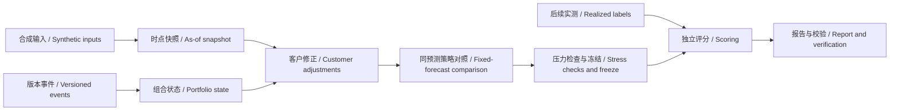

# 电力交易智能体 / Power Trading Agent

**v1.2.0 · 多维风控与决策复盘 / Multidimensional risk and decision review**

面向广东售电侧的辅助决策工程。v1.1 将框架落成可运行的快照、组合台账、策略对照、历史回放和独立验收程序。Python 3.9+，运行核心只使用标准库，无需模型账号。

A decision-support project for electricity retailers in Guangdong. v1.1 implements snapshots, portfolio records, strategy comparison, historical replay, and independent acceptance checks. Python 3.9+; the runtime uses only the standard library and requires no model credentials.

**当前范围：合成数据研究闭环。** 结算是明确标识的示例适配器，真实广东规则、真实模型成绩、生产数据连接和交易执行尚未验收。运行入口拒绝未标注为 `synthetic` 的输入。

**Scope: a complete synthetic research workflow.** Settlement is an explicitly synthetic adapter. Real Guangdong rules, model performance, production data integrations, and trading execution have not been accepted. The runner rejects inputs outside the `synthetic` scope.

## v1.2 新增 / New in v1.2

在 v1.1 基础上新增离线风控决策台与独立复盘页。三档限额覆盖价格、电量、合成偏差费用、持仓、支出代理量与新增损失；由你选择档位和方案。默认 9 项限额全部未填写，缺失或超限会阻断新选择。演示阈值仅用于展示，不是经营建议。

v1.2 adds an offline risk workspace and a separate review view. Three profiles contain nine independent limits across price, volume, synthetic fees, positions, outflow proxies, and incremental loss. You choose the profile and plan. All default limits are unset; missing or breached limits block new choices. Demo limits are illustrative only.

```bash
python3 -m power_trading_agent risk-demo --output runs/risk-demo
python3 -m power_trading_agent review-demo --output runs/review-day
python3 -m power_trading_agent review-demo --period-type month --output runs/review-month
```

打开 `runs/risk-demo/risk/risk.html` 比较 35 个压力场景与 11 个候选方案，导出研究选择草稿。打开 `runs/review-day/review/review.html` 查看当时选择、事前冻结的可行参考与仅供解释的事后参照。未提供执行证据时，选择不会被称为实际成交。月度按月单独复盘，用月前同一信息时点覆盖整月；当前仍是合成结算研究视图。

Open `runs/risk-demo/risk/risk.html` to compare 35 stress scenarios and 11 candidate plans and export a research choice draft. Open `runs/review-day/review/review.html` for the recorded choice, frozen ex-ante references, and explanatory hindsight comparison. A choice is not treated as execution without execution evidence. Monthly reviews freeze one origin before the entire calendar month and remain a synthetic accounting research view.

- [逐项解释、完整操作与边界 / Detailed guide and workflow](docs/risk-review-guide.md)
- [输入输出契约 / Contracts](docs/risk-review-contracts.md)
- [v1.2 验证记录 / Validation](docs/validation/v1.2-validation.md)

## 快速开始 / Quick start

下载仓库后，在仓库目录运行；无需先安装依赖。输出目录必须尚不存在，防止覆盖历史结果。

From the repository directory, run these commands; no dependency installation is needed. Output directories must be new to preserve prior results.

```bash
python3 -m power_trading_agent demo --output runs/demo-v1.1
python3 -m power_trading_agent verify --output runs/demo-v1.1
python3 -m power_trading_agent benchmark --output runs/acceptance-v1.1
python3 -m unittest discover -s tests -v
```

演示包含一个组合、两个虚拟客户、28个目标日、3种策略、2016条逐时策略记录。预测为此前可得七天数据的均值；压力情景只使用预测，不读取目标日实测。实测在决策冻结后用于评分。

The demo contains one portfolio, two invented customers, 28 delivery days, three strategies, and 2,016 hourly strategy rows. Forecasts use seven earlier available days. Stress scenarios consume forecasts, and realized labels are accessed only after the decision is frozen.

打开 `runs/demo-v1.1/report.md` 查看中英双语报告。完整数值在 `results.json` 和 `hourly.csv`，输入与情景均归档。也可先阅读已执行的[验证记录](docs/validation/v1.1-validation.md)和[示例报告](docs/validation/demo-report.md)。

Open `runs/demo-v1.1/report.md` for the bilingual report. Full numbers are in `results.json` and `hourly.csv`; inputs and scenarios are archived. See the executed [validation record](docs/validation/v1.1-validation.md) and [example report](docs/validation/demo-report.md).

## 已实现能力 / Implemented capabilities

| 能力 / Capability | v1.1 行为 / Behavior |
| --- | --- |
| 事前快照 / As-of snapshots | 按实际可得时点选修订，拒绝缺点、口径冲突及版本倒序 / Select available revisions; reject missing cells, basis conflicts, and inconsistent versions |
| 组合台账 / Portfolio ledger | SQLite 保存成交、采购意图、申报、客户事件；幂等接收与历史修订 / Separate filled trades, intentions, declarations, and customer events with idempotent revision history |
| 客户事件 / Customer events | 确认后的停复工影响对应客户及小时；歧义文字返回待澄清 / Confirmed events affect only the relevant customer and hours; ambiguous text requires clarification |
| 策略对照 / Strategy comparison | 同一 F 下比较 k=1、价差规则、半幅价差规则 / Compare baseline, spread rule, and half-adjustment rule on the same forecast |
| 数值风险接口 / Numerical risk API | 压力情景与概率情景分离；支持权重分数尾部 CVaR90，预算缺失不自动选择 / Separate stress and probability metrics; support fractional-tail weighted CVaR90; no automatic choice with missing budget |
| 历史回放 / Replay | 记录成本、相对增益、最差日、最大回撤和分组样本量 / Record costs, incremental gain, worst day, drawdown, and group counts |
| 本地协调 / Local coordination | 持久任务、执行代际、旧结果拒绝、取消与版本绑定选择；可恢复中断回放 / Durable tasks, generations, stale-result rejection, cancellation, version-bound selection, and replay recovery |
| 独立验收 / Independent acceptance | 固定业务案例及标准答案，与运行服务分开；金额与状态均评分 / Fixed business cases and oracle expectations separate from runtime services |
| 工具入口 / Tool interface | 有限 JSON 工具目录，可供后续模型宿主调用 / Bounded JSON tools ready for an optional model host |

策略均为可解释的规则基线；尚未实现约束优化器或强化学习。概率接口中的 `validated` 是调用方声明，不代表本仓库已完成概率校准；默认演示只提供无概率权重的压力情景。

Strategies are transparent rule baselines; a constrained optimizer and reinforcement learning are not implemented. `validated` in the probability interface is a caller assertion, not a calibration result produced by this repository. The default demo uses unweighted stress scenarios only.

## 工作流 / Workflow



沿用“一个协调器、业务服务、独立校验”的设计；v1.1 的协调器是确定性本地程序。JSON 工具可供模型选择调用，但当前未连接 DeepSeek Harness、外部 LLM 或交易平台。

The design retains one coordinator, business services, and independent validation. The v1.1 coordinator is deterministic and local. JSON tools can be called by a model host, but DeepSeek Harness, an external LLM, and exchange platforms are not connected in this release.

## 输入、恢复与工具 / Inputs, recovery, and tools

生成一份可编辑的合成输入，再运行自己的研究配置：

Generate an editable synthetic input and run a research configuration:

```bash
python3 -m power_trading_agent sample --output local/synthetic-input.json
python3 -m power_trading_agent run --input local/synthetic-input.json --output runs/custom-v1.1
python3 -m power_trading_agent resume --output runs/custom-v1.1
python3 -m power_trading_agent tools
python3 -m power_trading_agent tool --request examples/customer-event-request.json
```

`resume` 要求输入和代码未改变，复用已完成任务，重启未完成任务并拒绝旧执行器提交。修改输入、规则或代码后应使用新输出目录。自然语言入口仅支持文档中的绝对日期停工模板，输出仍为待确认事件；它不是通用语言理解模型。

`resume` requires unchanged inputs and code, reuses completed tasks, and restarts incomplete tasks with stale-worker rejection. Use a new output directory after changing input, rules, or code. Text intake supports only the documented absolute-date shutdown template and returns a pending event; it is not a general language model.

每个输出目录包含 / Each output directory contains:

| 文件 / File | 用途 / Purpose |
| --- | --- |
| `input.json`, `run_meta.json` | 冻结输入、版本与代码摘要 / Frozen input, version, and source hash |
| `ledger.sqlite3` | 本地可变台账，保存事件与任务；不属于静态文件校验清单 / Mutable local event/task ledger, excluded from static file checksums |
| `results.json` | 快照、完整情景、候选曲线、评分与分组 / Snapshots, scenarios, plans, scores, and groups |
| `hourly.csv`, `report.md` | 可核查明细与双语报告 / Inspectable detail and bilingual report |
| `manifest.json` | 静态产物摘要；verify 另做独立公式及逐时勾稽 / Static hashes plus independent arithmetic and hourly reconciliation via verify |

## 文档与后续 / Documentation and next steps

- [v1.1 计算方法与参考 / Methodology and references](docs/v1.1-methodology.md)
- [v1.1 接口契约 / Service contracts](docs/v1.1-contracts.md)
- [实施与验证记录 / Implementation record](docs/workflow/05-implementation-v1.1.md)
- [v1.0 历史架构 / Original architecture baseline](docs/power-trading-agent-framework.zh-CN.md)
- [DeepSeek Harness 开发 Skill / Development skills](https://github.com/MultiplyTen/deepseek-harness-skills)

后续按真实数据就绪、适用规则确认、模型滚动评价、影子运行的顺序推进。模型升级固定策略评价，策略升级固定预测评价；智能体升级单独评价时间、错误和调用成本。真实客户、合同、持仓、凭据继续保留在本地私密区。

Next steps are real-data readiness, applicable rule confirmation, rolling model evaluation, and shadow operation. Evaluate models under fixed policies, policies under fixed forecasts, and agents separately for time, errors, and tool cost. Real customer, contract, position, and credential data remain private and local.

更新时间 / Updated: **2026-11-06**
