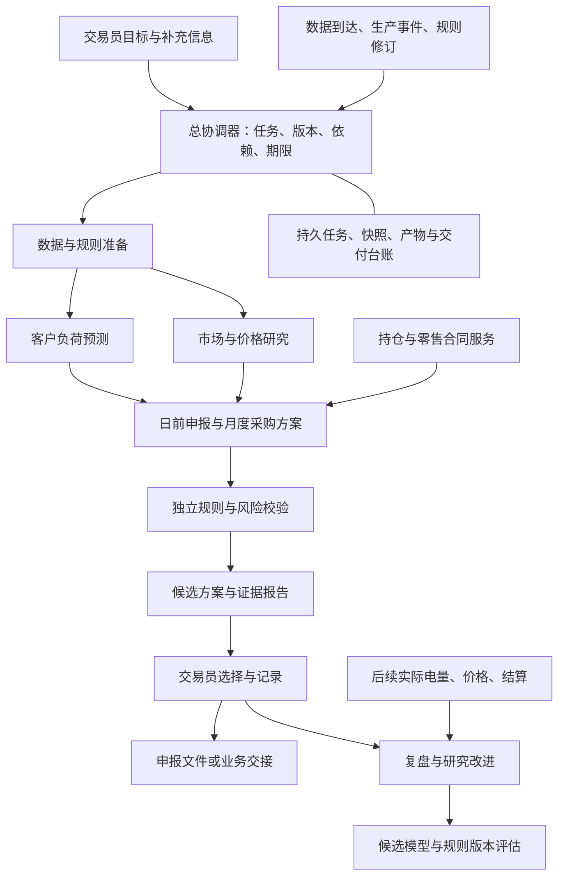

# 电力交易智能体框架设计 v1.0

[返回首页 / Back to README](../README.md)

日期：2026-11-02

定位：面向广东售电侧，连接数据、预测、申报与采购方案、风险检查和复盘的辅助决策系统。

文档状态：方案设计及实施基线；本仓库尚未提供运行系统、常驻服务或交易平台连接。

依据：五个 DeepSeek Harness Skill，以及作者本地四模块交易标准、月度方案与出清研究材料；来源范围见第11节。

## 1. 建设结论

建议采用 **一个总协调器、六类业务能力、一套独立校验与版本台账**。六类业务能力是逻辑职责，可以由程序、预测模型和按需调用的智能体共同承担，第一版不要求建立六个常驻模型会话。

大模型负责理解目标、组织任务、调用工具、解释证据和形成报告；确定性程序负责时间对齐、电量汇总、合同计算、结算情景、风险指标与勾稽；统计模型负责经过验证的预测。交易员负责选择业务方案及确认需要人工决定的事项。

建设时保留既有“四模块”主线：

**M1 数据治理 → M2 预测 → M3 方案与风险 → M4 复盘**。

新增的任务协调、事件处理、故障恢复、结果交付横跨四模块。月度项目已有的 M-01—M-08 编号与程序继续保留；下文 EA-M 编号仅表示本框架的接口职责，不替换原编号。

### 业务目标与需求基线

| 编号 | 目标 | 可以检查的完成表现 |
| --- | --- | --- |
| R01 | 每次分析知道用了什么数据 | 输出输入快照、来源版本、时间截点及缺口 |
| R02 | 预测负荷和价格可单独评价 | 同日型基准与候选模型在相同样本、相同可得条件下对照 |
| R03 | 把预测转成可比较方案 | 日前候选相对 k=1 比较；月度采购有独立持仓、价格和费用口径 |
| R04 | 计算和规则可追溯 | 数值由程序复算，规则注明来源、适用期和版本 |
| R05 | 多项任务可并行推进和恢复 | 日前、月度、复盘各有独立任务与执行记录，重启不覆盖旧成果 |
| R06 | 用户只需处理有意义的事项 | 通知完成、重要变化、失败和待决策事项，普通进度留在记录中 |
| R07 | 能查清建议、采用和实际的差异 | 保留预测、建议、用户选择、实际申报/成交、实际结算五条记录 |
| R08 | 研究成果能逐步接入真实工作 | 有研究、历史回放、影子运行和业务采用的独立验收门槛 |

## 2. 五个 Skill 如何落实到电力业务

| Skill | 提取的方法 | 在电力交易智能体中的实现 | 验收例子 |
| --- | --- | --- | --- |
| 01 插件配置 | 有类型的配置、默认值、运行时校验 | 市场区域、客户组合、数据截点、时段、价格口径、模型版本、风险预算都配置化；凭据由单独的凭据管理提供 | 缺风险预算不能自动补成“可承受损失”；显式 false 不被默认值覆盖；旧配置可回放 |
| 02 生命周期 | 依赖加载、资源归属、清理与重载 | 管理数据读取、模型任务、目录监听、数据库连接和后台计算的启动/停止 | 重启后没有重复任务；人工停止后不自动复活；依赖不可用时明确等待或降级 |
| 03 服务组合 | 契约、实现、工具入口分离 | 将数据读取、负荷预测、价格预测、持仓计算、风险计算、报告输出封装成稳定接口 | 换预测模型或数据源不需要重写协调器；各实现使用同一输入输出契约 |
| 04 打包分发 | 实际产物检查、依赖锁定、运行配置激活 | 分别交付计算核心、宿主适配器、配置样例和研究数据；研究与业务运行使用不同配置 | 在干净环境加载同一包，验证实际生效配置、依赖和移除；包中不含客户明细或凭据 |
| 05 Super-agent | 协调/执行分工、事件、持久状态、监督和交付 | 用一个协调器管理日前、月度、异常和复盘任务；输入更新触发相关任务的新版本 | 重复事件不重复工作，迟到执行器不能写回，报告与人工选择绑定具体版本 |

Skill 是工作方法，实际能力由工具和运行时实现。这里采用的是这些方法；Harness 是否作为最终宿主，需要在选定版本上完成小规模兼容性验证。

## 3. 总体结构



上图是拟建业务架构，不是当前已运行系统的调用图。“独立校验”指单独的计算入口与检查标准，不要求另开一个大模型；同一模型的第二段自我检查不能替代程序复算。

### 六类业务能力

| 能力 | 具体工作 | 主要交付 |
| --- | --- | --- |
| 数据与规则准备 | 客户电量、天气版本、市场披露、生产事件、合同及规则来源核查 | 数据就绪单、快照、缺口与规则适用表 |
| 客户负荷预测 | 逐户/组合预测，日历、天气、停复工、实际电量延迟处理 | F 曲线、情景/经验证的区间、客户解释与模型成绩 |
| 市场与价格研究 | 用户侧 DA、RT、价差及供需风险分析；节点研究单列 | 价格预测版本、情景、风险事件与证据 |
| 申报与采购方案 | 日前 Q=kF 候选；月度需求、持仓、交割曲线和采购比较 | 基准与候选方案、敞口、费用及适用条件 |
| 规则与风险校验 | 版本一致性、时点、单位、适用规则、金额复算及风险限制 | 通过/需补充/不可发布的检查结论和原因 |
| 复盘与改进 | 预测误差、建议与采用差异、结算对账、候选实验 | 复盘报告、问题定位与下一轮实验任务 |

总协调器保存目标、任务关系、状态、截止时间和证据索引。每个执行任务只取得必要的客户范围与数据快照，大表和详细日志存于文件/数据库，通过稳定标识按需读取。

## 4. 模块、接口和异常处理

以下接口名称是本项目拟定义的接口，不是声称 Harness 已提供的 API。

| 模块 | 对应需求 | 输入与处理 | 输出/接口 | 异常与验证 |
| --- | --- | --- | --- | --- |
| EA-M01 数据与快照 | R01、R04 | 来源记录、客户范围、信息截点；解析、单位校验、历史可得选版 | `build_snapshot`：快照ID、质量状态、缺口和证据 | 无历史时点证据标记未认证；缺失不填0；同快照可重现 |
| EA-M02 规则注册与适用 | R04、R08 | 来源原文、市场、有效期、主体、品种和修订关系 | `resolve_rules`：适用规则版本及待核项 | 文档抽取先作候选；冲突或关键参数缺失时不发布正式费用结论 |
| EA-M03 负荷预测 | R02 | EA-M01快照、客户事件、预测起点与期限、模型配置 | `forecast_load`：F、模型版本、状态和评价记录 | 可得实际电量滞后按客户记录；生产事件不能直接当零负荷 |
| EA-M04 价格与联合情景 | R02、R03 | 同一快照、用户侧价格定义；情景生成另接收EA-M03发布的F、负荷误差/校准版本及跨变量依赖模型版本 | `forecast_market`、`build_scenarios`：DA/RT/S及完整日联合情景 | 缺校准时只报研究区间/压力情景；不能把敏感性九宫格赋成已验证概率 |
| EA-M05 持仓与候选策略 | R03、R07 | 同一预测版本、联合情景、持仓/合同版本、规则和候选边界 | `evaluate_daily_plans`、`compare_monthly_plans`：候选ID、基准差异和敞口 | 缺交割曲线不按月总量伪造小时持仓；月度与日前分别建模 |
| EA-M06 独立校验与发布 | R04、R07 | 候选产物、快照/规则/模型/持仓版本和风险约束 | `validate_plan`、`publish_candidate`：检查记录、发布产物哈希 | 快照不一致、规则过期、越界或金额不符时阻止相关发布；保留诊断结果 |
| EA-M07 交付与复盘 | R06、R07 | 合格候选、用户选择、实际采用和后续结算 | `render_report`、`reconcile_run`：报告、导出、差异和实验候选 | 实际数据未齐时保持待复盘；新版本不覆盖旧预测；归因不把相关性当因果 |
| EA-M08 任务与运行协调 | R05、R06、R08 | 用户请求、数据事件、任务依赖与授权范围 | 接纳、排队、分派、恢复、通知及审计 | 去重、执行代际、有限重试、尊重停止；未知外部状态先核对 |

### 确定性服务与模型的边界

- 规则适配器接受明确参数并计算费用；语言模型可以解释来源，不能直接改写适用公式。
- 预测服务发布一次结果。策略服务消费该结果；若需要另一模型，建立有独立版本的实验。
- 负荷和价格预测可并行执行；联合情景生成必须等待两者的兼容发布结果，绑定同一次F与对应误差分布。
- 报告中的表、图、文字数值引用同一结构化结果，避免不同段落各算一遍。
- 输入中的文章、公告、客户备注只作为业务材料，不具有修改系统权限或执行范围的作用。

## 5. 贯穿全流程的数据契约

### 时间与数量

统一业务时区为 Asia/Shanghai。来源保留原粒度，业务视图按已确认规则转换为小时；15分钟平均功率转电量需要乘有效小时数，电量按时段求和。价格按适用结算口径处理。

- F：本次发布的预测负荷，单位 MWh。
- L：事后实际电量，或预测阶段联合情景中的实际负荷假设，单位 MWh。
- Q：候选/采用/实际申报电量，分别保存；候选关系为 Q=kF。
- DA、RT：同一用户侧价格口径下的日前、实时价格，单位元/MWh。
- S：RT−DA；费用、损益和风险金额统一为元。

客户生产事件先改变 F；k 表示价格与风险条件下的申报选择，不能把同一停复工影响计算两次。日前候选边界来自业务配置；旧标准中的系数范围不能解释为现行市场规则或偏差免考核范围。

### 最小持久记录

| 对象 | 最小关键字段 |
| --- | --- |
| 来源记录 | 来源/对象/指标、原值、单位、目标区间、issue_time、received_at、available_time、source_version、质量状态、哈希 |
| 快照 | snapshot_id、forecast_origin、客户范围、记录版本清单、转换版本、缺口、来源哈希 |
| 业务任务 | task_id、组合、目标日或月份、业务类型、范围、期限、状态、输入修订号 |
| 执行 | run_id、task_id、assignment_id、generation、输入快照、模型/代码/配置版本、依赖锁定版本、模型产物哈希、随机种子/采样参数、产物索引 |
| 联合情景 | scenario_set_id、预测发布版本、scenario_id、scenario_weight、目标区间、场景L、DA/RT/S、负荷误差/校准/依赖模型版本及集合哈希 |
| 候选方案 | plan_id、预测发布版本、scenario_set_id、规则/持仓/合同版本、F/k/Q、成本和风险口径、状态、产物哈希 |
| 人工选择 | decision_id、对应plan_id与哈希、选择人、时间、动作、适用账户/组合/目标期、有效期 |
| 实际结果 | 实际申报/成交记录、平台回执、实际L/价格、结算版本、费用项及对账状态 |
| 交付意图 | effect_id、任务/产物哈希、目标、尝试次数、发送状态、回执、最后核对时间 |

历史回放只能使用 `available_time ≤ forecast_origin` 的记录。缺少历史可得性证据时，回放仍可用于研究，但不称为严格事前回测。后到的实测或修订数据新增版本，不回填修改原预测快照。

概率情景的权重非负、合计为1，每条情景覆盖完整目标日，场景内S=RT−DA；F固定为本次发布的申报基础，L随情景变化。未建立概率依据的压力情景不强填概率权重，也不输出冒充概率估计的期望损益。

归档实际采用的情景集合、计算输入和结果，而不只保存生成脚本。可复算指从这些归档输入复算业务数值；非确定性外部模型的文本回答另存调用记录，不要求再次调用产生逐字相同内容。

### 规则、模型与场景的有效性

规则版本保存来源、适用地区/主体/品种、有效期和确认记录。已归档规则用于对应历史业务；当前业务需重新判断适用性。本设计不认定任何具体结算政策为现行有效规则。

模型注册表至少区分研究候选、已验证候选、影子运行、业务采用及退役。复盘提出新模型候选，不能自行替换业务采用版本。

概率分位数须有独立时序校准证据；联合场景须保留价格与负荷误差依赖和跨小时依赖。完整日风险由完整日损益计算，不能将24个小时的CVaR相加。风险预算未确定时呈现方案与风险曲线，不默认填入可承受金额。

## 6. 三条业务流程

### 6.1 日前辅助决策：第一版最小闭环

场景请求：“为目标日 D、客户组合 P 生成日前申报候选，并与基准比较。”

1. 建立独立任务，明确目标日、组合、信息截点、交付时间和当前授权范围。既有规范的12:00为用户业务工作边界，实施时重新配置实际时间，不宣称它是已核实的市场正式截止。
2. 检查实际收到的客户电量、天气签发版本、市场披露、生产事件、持仓和规则。输出就绪单，关键缺口进入待补状态。
3. 冻结同一快照，计算客户负荷 F 与用户侧 DA/RT/S。模型不具备有效区间时如实标为研究输出。
4. 生成完整日联合情景或清楚标注的压力情景，分别处理概率评估与条件敏感性分析。
5. 计算 k=1 基准与候选方案。结算服务在相同持仓、规则、费用和负荷场景下比较，另报整体敞口；不能把相对基准净增益称为公司全部利润。
6. 独立校验数据截点、版本、单位、费用、风险和汇总。交付候选曲线、对比表、缺口、关键假设及证据索引。
7. 记录交易员的选择与实际采用量。第一版可导出申报文件，并保存文件哈希；导出不等同交易平台已经接收。
8. 实际电量、价格和结算材料到齐后创建复盘任务，对齐原快照，定位负荷、价格、策略和费用影响。

### 6.2 月度采购：复用现有 M-01—M-08

```text
M-01 输入核查 → M-02 历史回顾 → M-03 月度需求
→ M-04 外部市场证据 → M-05 价格研究
→ M-06 持仓与合同 → M-07 方案比较 → M-08 报告与归档
```

协调器调用既有模块入口，记录模块依赖和数据版本。月度需求覆盖完整自然月，检查小时、日、月加总一致性；长期与月度持仓按交割曲线映射。月度采购的目标、约束、考核和费用独立配置，不直接套用日前 k 策略。

当前 M-07 的九组量价敏感性可以作为研究工具；加入概率、期望成本、CVaR或完整利润优化，需要新的输入、计算服务和独立验收。

### 6.3 事件更新：只重算受影响的链条

例如，收到某客户的新停复工日期：

1. 验证来源、知晓时点与客户映射，形成事件版本；重复投递沿用原接纳结果。
2. 查找该客户、有效时段关联的日前/月度任务，向相应任务追加输入。
3. 生成新快照和新运行，更新受影响的负荷、方案、风险与报告；保留原版本。
4. 将依赖旧输入的未执行候选标记为过期。已有人工选择需要检查是否仍覆盖新产物；选择A版不能自动作为B版的确认。
5. 若已经实际申报，记录影响并形成新的待处理事项，不能把数据库重算当成已修改平台申报。
6. 仅在方案变化达到事先配置的业务阈值、重要缺口、失败或需要选择时通知用户。原有分析授权内的计算可继续，不把每个内部步骤都改成人工审批。

## 7. 协调、恢复与监督

### 任务状态与业务就绪分开

执行状态可用：`queued → running → completed`，以及 `waiting_input / waiting_dependency / failed / cancelled / superseded`。

业务结果另用：`research_only / ready_for_review / needs_input / invalid`。程序退出码为0、任务执行完成，都不能自动意味着业务方案可采用。每个状态转换记录原因和对应证据。

### 必要运行机制

- **事件去重**：使用来源、稳定事件ID和来源修订号；相同文件哈希可用于辅助识别，不能仅按文件名去重。
- **任务隔离**：组合、目标期、业务类型与版本组成定位条件；聊天窗口不是唯一任务键，订阅只传递相关输入。
- **执行代际**：重派产生新 assignment/generation；提交时同时校验执行代际及输入修订，旧执行器不能覆盖新结果。
- **有限恢复**：瞬时依赖错误可按明确预算重试；坏数据和未知规则进入补充/修复流程。到达业务期限前不能无限重试。
- **事务与交付**：状态和交付意图在同一事务写入，提交后执行交付。重试沿用相同意图ID和内容哈希。
- **外部状态未知**：如未来接入交易平台，发生“已发出但无回执”时先查询和对账。平台无幂等或查询能力时交由人工核对，不能自动新建一笔重报。
- **监督**：分别检查进程活性、任务进展、数据新鲜度、规则有效期与产物一致性。服务活着但连续使用旧数据也应触发业务问题。
- **尊重停止**：人工停止作为持久状态保留；后台恢复不得自动撤销。

### 初期运行方式

优先单机、单协调写入者，复用现有 Python 计算程序和文件/数据库产物。共享业务数据库保持只读；新任务状态存入单独台账，客户明细沿用本地私密区。需要并发时增加执行器和队列，不先承担分布式锁与多主写入成本。

若选用 DeepSeek Harness，增加一个薄的宿主适配层来调用上述服务。先用模拟数据验证服务依赖、配置校验、加载/卸载、一次任务恢复和结果返回，再决定实际宿主版本与部署方式。资料中的历史 Node/DSH 要求不作为当前环境已兼容的证明。

## 8. 现有项目的复用结论

以下为2026-11-02对文件和历史验证记录的只读核查，不代表本次重新运行系统或查询数据库覆盖。

| 现有成果 | 可复用部分 | 接入智能体前的工作 |
| --- | --- | --- |
| 四模块跨环境标准 v1.1 | 输入时点、字段、F/L/Q、模型对照、联合场景和评价标准 | 转成可执行接口与检查；标准本身不证明模型效果 |
| 月度 M-01 | 输入校验、快照、运行版本、依赖失效记录 | 接真实来源和事件入口；已有运行台账不等于任务租约/Outbox协调库 |
| 月度 M-02/M-03 | 回顾、客户名册、事件修正、候选预测与聚合检查 | 验证真实负荷、近期生产信息及概率输出；新增画像算法设计未等于实现 |
| 月度 M-04/M-05 | 市场证据契约、DA/RT/价差研究接口 | 实际采集、历史可得时点、真实模型和概率校准；煤气背景变量需单独验证增量价值 |
| 月度 M-06 | 持仓、零售合同、曲线和逐时敞口 | 真实合同、成交、费用税口径及规则适用验收 |
| 月度 M-07 | 同快照候选比较、九组量价敏感性、内部条件检查 | 概率风险、完整收益和日前系数引擎另建，不把现有敏感性称为完整优化 |
| 月度 M-08 | 统一指标、Word/PDF等同源报告、版本差异和白名单归档 | 真实业务数值及用途中立的复算验收；只向用户指定位置交付 |
| 电策工作台 | 八页静态交互设计 | 接 Python 接口、任务状态和真实数据后才能成为业务界面 |
| 日前实时出清研究系统 | SCUC/SCED及价格机制的合成情景研究、输入与诊断留痕 | 隔离作为研究工具；五节点合成模型不作为广东真实出清或正式结算引擎 |

历史 M-08 验证记录写明 synthetic、492项测试，且 business_ready、production_approved、deployed 均为 false。复用它的工程成果，同时保留这些状态。当前真实数据覆盖应在接入阶段另查，不能沿用旧覆盖日期。

## 9. 分阶段推进及验收

| 阶段 | 交付物 | 进入下一阶段的条件 |
| --- | --- | --- |
| P0 业务与输入基线 | 一个客户组合、目标场景、价格/规则适用表、数据可得清单、风险参数待核清单 | 关键字段与版本明确；未知项有处理路径 |
| P1 最小闭环 | 单组合、单目标日、24小时候选报告；现有程序封装为服务；可复现运行包 | 同快照数值可复算，重复事件/重启/迟到结果等故障通过；关键缺口不会伪装成合格结果 |
| P2 历史与影子评价 | 时间滚动回放和真实时点影子运行，逐期限、客户、月份和价格状态评价 | 预先确定的预测、校准、成本与风险标准达标；历史可得性未认证的数据单列 |
| P3 日常辅助运行 | 按已配置任务接收资料、生成方案、提示重要变化，记录人工选择及复盘 | 持续运行、截止时间、数据修订、恢复、降级和版本追溯通过 |
| P4 可选的业务执行连接 | 经授权的平台适配器、版本绑定的动作记录、回执与对账 | 平台权限、接口语义、幂等/查询、规则、风险限制、人工接管和失败恢复分别验收 |

优先选择日前辅助分析作为最小样板，同时用月度项目既有模块验证服务封装；待相同契约稳定后扩展到2—7天和月前任务。各期限保留各自的信息起点与验收成绩。

### 首轮必须通过的故障与业务检查

1. 历史截点后修订的天气、供需和价格信息不能进入原预测。
2. 15分钟缺点保持缺失，MW/MWh误用和用户侧/节点价格混用被识别。
3. 修改F后，下游Q与方案重建，旧方案过期，原预测记录保留。
4. 候选与k=1在同一规则、持仓和场景下比较；另行显示基准敞口。
5. 两个任务交错收到输入时，客户、目标期和上下文不串线。
6. 重复事件、运行中重启和旧执行器迟到提交不产生重复结果或覆盖。
7. 规则缺失、校准缺失和风险预算未知，分别进入明确的研究/待补状态。
8. 用户选定A版后到来重要修订，新B版不得沿用不再适用的选择记录。
9. 交付成功但回执丢失时保留未知状态并核对；不无条件承诺外部 exactly-once。
10. 普通进度不反复通知，重要变化可达；人工停止可跨重启保持。

本节是拟执行的验收清单，本次未开展上述新系统实验。学习用协调器通过的十项离线测试不能替代这些电力业务验收。

## 10. 下一步的具体实施任务

| 顺序 | 任务 | 输出 |
| --- | --- | --- |
| T01 | 选定首个组合和日前场景，核对本地数据及规则来源 | 输入审计、缺口、信息截点、单位/价格定义 |
| T02 | 统一现有模块的请求/结果结构，保持旧程序可独立运行 | 快照、预测、情景、方案、复盘五类契约及版本链 |
| T03 | 为现有数据/预测/持仓/报告程序增加最小适配器 | 可调用服务和错误/缺口返回，不把退出码当业务状态 |
| T04 | 实现任务台账、事件去重、依赖更新与执行代际 | 可恢复的单协调器闭环 |
| T05 | 加入独立计算校验和本地候选报告发布 | 可复算报告、人工选择记录和申报导出 |
| T06 | 执行故障检查与时间滚动评价 | 实际验收结果、缺陷和是否进入影子运行的结论 |

决定正式方案采用前仍需明确：首个客户组合与范围、用户侧价格口径、适用结算条款及有效期、当前持仓/合同、实际数据截点、风险金额与运行环境。这些缺口不影响先完成接口、台账和模拟事件验证。

## 11. 依据、检查结论与使用方式

### 公开来源与本地材料说明

- [五个 DeepSeek Harness Skill](https://github.com/MultiplyTen/deepseek-harness-skills/tree/c1a27df10e0b9d50677454e91c59d0a8b7246cd5/skills)：配置、生命周期、服务契约、包检查、协调与执行分离及恢复方法。
- [Super-agent 设计与验收指南](https://github.com/MultiplyTen/deepseek-harness-skills/blob/c1a27df10e0b9d50677454e91c59d0a8b7246cd5/skills/deepseek-harness-05-superagent/references/architecture.md)：协调、事件、上下文、持久状态和监督的设计依据。
- [官方原型与文章设计对照](https://github.com/MultiplyTen/deepseek-harness-skills/blob/c1a27df10e0b9d50677454e91c59d0a8b7246cd5/skills/deepseek-harness-05-superagent/references/prototype-map.md)：公开研究原型的证据与能力边界。

业务设计还参考了作者本地的“四模块交易系统跨环境标准 v1.1”、月度交易方案模块说明、历史虚拟数据验证记录及合成出清研究系统说明。这些私有材料和底层项目未随本仓库发布。

第8节的既有成果、历史测试数量和状态属于2026-11-02的本地材料审阅记录，不是本仓库内可重新执行的测试证据。公开读者应将它们视为复用背景；本仓库交付的是架构与实施方案。具体数据源、客户、合同、模型、业务规则和运行环境仍需各使用者自行核实。

### 本步结论

方案设计已完成，R01—R08均映射到模块、输入输出、异常处理和验证思路；项目事实按只读材料核查，未将历史测试当成本次重新验证。并行复核补齐了联合情景对负荷发布结果的依赖，以及随机性、依赖环境与情景归档的可复算要求。正式业务采用所需数据、规则、模型和风险金额仍待实施阶段核实。

这份文件可作为后续开发的共享基线：每次实现先读取相关章节、现有项目约定和实际版本，再记录新增代码、检查结果与未验证项。这套方法落实为可审阅的架构与契约；实际能力须以相应实现与验收记录为准。
